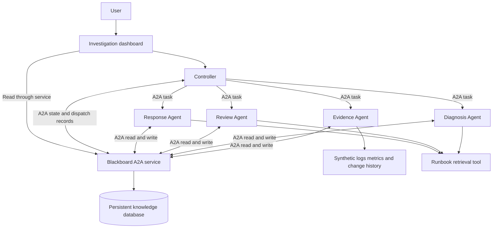

# Blackboard project implementation plan

## Primary goal

Build a working campus IT incident investigator in which specialist AI agents share evidence, challenge and revise explanations, and produce an evidence-backed response plan. During a 10–12 minute live presentation, the audience should see the agents collaborate through an A2A Blackboard service and understand why the controller chooses each next action.

Status: implemented local prototype. The offline fixture workflow and current source have been verified; see [implementation status](docs/implementation-status.md), [independent verification](docs/verification-report.md), and [code review](docs/code-review.md) for measured evidence and limits. Live-provider behavior, external pricing, and final student submissions remain unverified. Prepared 6 November 2026.

## 1. Requirements and scope

### Sources and interpretation

- [Assessment brief](<./MAAI904 Assessment 2 2026.docx>), opening, Deliverables, and Marking Criteria: authoritative local source for assessment weight, timing, submissions, and rubric.
- [Blackboard project description](<./Project idea 2- Blackboard system on top of A2A.docx>), sections 1–5 and 8: architectural guidance, suggested operations, iterative reasoning, and engineering considerations.
- [Agent Societies description](<./Project Idea 3 LLM Agent Societies.docx>), header and Deliverables: checked only to avoid importing its conflicting experimental requirements into this project.

The main brief says 30% of the course grade and end of Week 11. It says each group “could have 2 members”; this plan assumes two people without interpreting that wording as a strict maximum. No calendar deadline is provided. Check Moodle for the actual submission time and later announcements before fixing the work schedule.

The Agent Societies document lists a different assessment weight, team size, and submission schedule. Its six-agent minimum, repeated experimental conditions, simulated days, proposal, and statistics are not stated Blackboard requirements.

| Assessment requirement | Planned evidence |
| --- | --- |
| Functioning system performing a coordinated AI-driven task | A synthetic incident moves from symptoms through investigation to a reviewed response plan |
| Agent orchestration | Controller selects agents according to unresolved questions and Blackboard revisions |
| Tool usage | Evidence queries over local log/metric fixtures and retrieval from a small runbook library |
| Memory and context handling | Persistent findings and revisions; agents receive relevant evidence and what changed since their previous turn |
| Agent-to-agent communication | Real A2A discovery and SDK message/task exchanges between controller, specialists, and Blackboard |
| 10–12 minute live presentation | An 11-minute script with a live investigation and visible evidence history |
| Presentation deck with architecture diagram | Approximately eight slides, including a component diagram and one annotated communication sequence |
| Code repository and tool screenshots | Source, locked dependencies, fixtures, setup instructions, execution commands, and screenshots of actual runs |
| Implementation summary of 5–7 pages | A proposed seven-page outline appears below |

### Decisions made for this plan

The campus IT scenario, four specialist agents, interface, database, and evaluation cases below are proposed design choices. The course does not prescribe these exact choices. Healthcare in the topic description is an example; this project uses synthetic campus service incidents to keep data preparation and demonstration manageable.

The prototype will investigate incidents and recommend actions. Its tools operate on supplied local fixtures. A completed investigation means the proposed explanation and plan passed review; it does not mean a real outage was repaired.

### Scope priorities

**Core scope:** independent A2A services, persistent Blackboard, four specialist roles, tool calls, evidence references, competing hypotheses, one visible evidence-request loop, bounded controller, investigation dashboard, and required submission materials.

**Add after the core works:** exportable investigation report, simple replay from a recorded run, side-by-side hypothesis comparison, or a second reviewer perspective. Replay must be visibly labelled as recorded.

**Deferred:** Pub/Sub broker, real campus integration, automatic remediation, cloud deployment, multiple model providers, vector database, complex login system, and general-purpose workflow builder. None is needed to demonstrate this chosen architecture.

## 2. Proposed project

**Title:** Campus IT Incident Investigator using a Blackboard and A2A.

A user selects a simulated incident such as “The student learning portal is slow and intermittently unavailable.” Agents gather observations, propose possible causes, check those explanations against evidence, request missing information, and generate a response plan with supporting references.

### Main demonstration case

1. Initial symptoms show elevated latency and intermittent failures. Traffic overload and database connection exhaustion are both plausible hypotheses.
2. Evidence Agent obtains the first measurements and attaches tool provenance.
3. Diagnosis Agent records at least two candidate explanations and identifies what would distinguish them.
4. Review Agent flags an evidence gap, such as missing connection-pool statistics, rather than approving an unsupported explanation.
5. Controller dispatches Evidence Agent for the requested measurement. The evidence becomes available through a tool query, not through a hard-coded final diagnosis.
6. Normal traffic and CPU readings weaken the overload explanation; pool saturation and connection timeout logs support the database explanation.
7. Diagnosis Agent adds a new revision, retaining the earlier hypothesis and showing which evidence changed its assessment.
8. Response Agent retrieves the relevant runbook and proposes bounded diagnostic and recovery steps. Review Agent checks the proposal against the evidence and runbook.
9. Controller closes the investigation only if the completion conditions are satisfied. Otherwise it records an unresolved or blocked outcome.

The fixtures determine ground truth; the model's wording and exact decisions may vary. Do not force a false disagreement simply to produce a dramatic demo. Build a deliberately ambiguous initial observation set and verify that it genuinely requires another query.

### Components and responsibilities

| Component | Responsibilities | Inputs and tools | Blackboard contributions |
| --- | --- | --- | --- |
| Evidence Agent | Select and gather measurements relevant to an open question | Allowlisted `query_metrics`, `query_logs`, and `get_change_history` tools over synthetic data | Observations, tool results, evidence availability notices |
| Diagnosis Agent | Compare explanations, identify missing facts, revise hypotheses | Current evidence, prior hypotheses, runbook search | Hypotheses, evidence references, requests for additional observations |
| Review Agent | Challenge unsupported conclusions and check response plans | Evidence, hypothesis revisions, runbooks, proposed actions | Reviews, conflicts, evidence requests, acceptance or rejection with reasons |
| Response Agent | Produce a practical response proposal and handover summary | Reviewed diagnosis, relevant runbooks, unresolved caveats | Proposed solution, action checklist, evidence/runbook references |
| Blackboard service | Validate requests, store and retrieve knowledge, enforce revisions and ownership | A2A application actions and persistent database | Canonical history and problem status |
| Controller | Select useful next work, enforce limits, track task results, determine completion | Blackboard state and specialist Agent Cards | Dispatch records, scheduling reasons, investigation status |
| Dashboard | Let the user start a case and inspect progress | Controller start/status API and Blackboard reads | User-facing views only; it does not directly edit the database |

The Blackboard and controller are software services; their scheduling and storage logic should be deterministic. The four specialists use an LLM for bounded choices or reasoning, with different roles and tool permissions. They can share one model. Distinct model providers are unnecessary.

### Architecture



Only Blackboard storage code opens the knowledge database. Specialists collaborate by reading and contributing knowledge through the Blackboard, while the controller delegates work through A2A. Polling state revisions is sufficient for the core prototype; a message broker is optional.

### Proposed stack

| Area | Choice and rationale |
| --- | --- |
| Language | Python 3.11 or 3.12, choosing one after the compatibility spike and recording it |
| Agent communication | `a2a-sdk[fastapi]==1.3.0`, using one JSON-RPC binding and protocol 1.0 throughout |
| Service host | FastAPI with the SDK's official route factories; Uvicorn for local processes |
| Agent logic | Small plain Python role modules plus one model-provider adapter; the official A2A SDK handles communication |
| Model | One available tool-capable model, selected after a small latency/output pilot; record the exact identifier and configuration |
| Application validation | Pydantic models for project-owned requests, findings, and agent outputs |
| Storage | SQLite behind one Blackboard service for a local demo; migrate to PostgreSQL only if demonstrated concurrency demands it |
| UI | Streamlit showing case status, evidence, hypotheses, decisions, and final recommendation |
| Tests | Pytest for application behavior and integration checks using the real A2A transport |
| Knowledge retrieval | Small curated Markdown/JSON runbook collection with simple keyword search and stable source IDs |

CrewAI/LangGraph and PostgreSQL/MongoDB are suggestions in the topic document, not compulsory technologies. The simpler stack reduces integration work while preserving the required architecture. SQLite is suitable here because it avoids another database server; writes still need short transactions and revision checks. See the [official Python SQLite tutorial](https://docs.python.org/3.11/library/sqlite3.html#tutorial).

## Phase 0 — Documentation discovery and compatibility

**How this serves the primary goal:** establish a working, documented communication foundation so the live demo demonstrates genuine A2A interoperability.

**Planning discovery completed:** reread the full assessment and Blackboard documents; checked tagged A2A Python SDK examples and official validation/UI/database documentation. **Still to execute:** install a compatible environment and prove one complete round trip before building the system.

### Verified reference patterns and allowed APIs

| Purpose | Verified API or source pattern | Copy reference |
| --- | --- | --- |
| A2A executor | `AgentExecutor.execute(self, context, event_queue)` and `cancel(self, context, event_queue)` | [Tagged server sample, executor](https://github.com/a2aproject/a2a-python/blob/v1.3.0/samples/hello_world_agent.py#L39) |
| Request handler | `DefaultRequestHandler(agent_executor=..., task_store=..., agent_card=...)` | [Tagged server sample, handler assembly](https://github.com/a2aproject/a2a-python/blob/v1.3.0/samples/hello_world_agent.py#L192) |
| HTTP integration | `add_a2a_routes_to_fastapi`, `create_agent_card_routes`, `create_jsonrpc_routes` | Same tagged server sample; copy JSON-RPC and Agent Card routes |
| Discovery | `/.well-known/agent-card.json`; Agent Card declares skills and supported interfaces | [Tagged card setup](https://github.com/a2aproject/a2a-python/blob/v1.3.0/samples/hello_world_agent.py#L136) |
| Client | `create_client(base_url, client_config=ClientConfig(supported_protocol_bindings=["JSONRPC"]))` | [Tagged client sample](https://github.com/a2aproject/a2a-python/blob/v1.3.0/samples/cli.py#L70) |
| Send/receive | `SendMessageRequest(message=Message(...))`; consume `client.send_message(request)` with `async for` | [Tagged client send pattern](https://github.com/a2aproject/a2a-python/blob/v1.3.0/samples/cli.py#L105) |
| Structured A2A payload | v1 `Part(data=...)` uses protobuf data, with `ParseDict(payload, Value())` | [SDK v1 migration guide, Message and Part construction](https://github.com/a2aproject/a2a-python/blob/v1.3.0/docs/migrations/v1_0/README.md) |
| Long task lifecycle | `TaskUpdater.start_work()`, `add_artifact(...)`, `complete()` | Tagged server executor sample above |
| Project data validation | `BaseModel`, `model_validate`, `model_dump` | [Pydantic models documentation](https://pydantic.dev/docs/validation/latest/concepts/models/) |
| Dashboard updates | `st.fragment(run_every=...)` for a periodically refreshed status view | [Streamlit fragment API](https://docs.streamlit.io/develop/api-reference/execution-flow/st.fragment) |

**Tasks:** copy the minimal SDK server/client patterns into an isolated spike; remove unused transports; prove structured request and response; then prove one task with a terminal result. Pin the complete compatible dependency set in a lock file. Record the protocol and SDK versions in the README. Read the tagged source before copying; examples were reviewed for this plan but have not been executed.

**Verification:** a second process discovers the card, sends structured data through the SDK, receives the expected data, and closes the client. Capture the card and one sanitized request/response as evidence. Confirm the application works with the pinned versions.

**Guards:** older `A2AStarletteApplication`/`a2a.server.apps` examples and v0.3 types must not be mixed with SDK v1. Do not treat SDK protobuf message objects as Pydantic models. Blackboard action names are payload values, not native RPC methods. The A2A task store is separate from the persistent Blackboard knowledge database.

**Exit:** one reproducible A2A round trip and a locked environment. Stop adding features until this passes.

## Phase 1 — Define cases, contracts, and success criteria

**How this serves the primary goal:** create an investigation that visibly benefits from several agents and gives the team a clear definition of a correct outcome.

**Implement:** write a one-page scenario brief; create three synthetic fixture sets; define entry/output schemas; write role prompts and completion rules before connecting models.

| Case | Purpose | Expected behavior |
| --- | --- | --- |
| Database connection exhaustion | Main demo with ambiguous first evidence | Request another measurement; preserve and revise competing hypotheses; recommend runbook-backed steps |
| DNS configuration fault | Show the system responds to different evidence | Select DNS evidence and produce a different supported diagnosis |
| Insufficient or unavailable evidence | Show honest termination | Record missing information and finish as unresolved or blocked without inventing findings |

Give each fixture a ground-truth answer file available to evaluation code only. Store tool-visible data separately. Make at least one decisive measurement available only through a targeted follow-up query. Define expected invariants rather than exact model wording or an exact agent sequence.

### Knowledge model

| Record | Required fields |
| --- | --- |
| Problem | `problem_id`, title, status, current board revision, timestamps, configured limits |
| Entry | `entry_id`, `problem_id`, type, author, timestamp, schema version, payload |
| Revision | logical entry ID, revision number, previous revision ID, reason for update |
| Evidence | tool name, query arguments, fixture/source ID, observed timestamp, raw-result reference |
| Hypothesis | claim, status, supporting IDs, contradicting IDs, open questions, previous revision |
| Review | target entry and exact revision, verdict, supporting evidence IDs, required follow-up |
| Dispatch | dispatch ID, agent, trigger/reason, board revision read, task status, result entry IDs |
| Audit event | request ID, operation, actor, problem, affected entries, outcome, duration |

Entry types: `observation`, `hypothesis`, `evidence_request`, `review`, `solution`, and `controller_decision`. Hypothesis states: `proposed`, `supported`, `weakened`, `rejected`, `unresolved`. Model confidence, if displayed, is an uncalibrated self-assessment; it is not a completion criterion.

**References:** Blackboard description sections 1, 3, 4, and 8; Pydantic model reference in Phase 0.

**Verification:** manually walk all three cases using draft entries; prove the first case needs additional evidence and the third cannot satisfy completion. Ensure every proposed conclusion can cite accessible evidence.

**Guards:** exclude ground-truth answers from prompts and tools; distinguish a tool observation from an agent interpretation; keep unknown facts unknown.

**Exit:** fixture files, role contracts, schemas, and a written acceptance checklist.

## Phase 2 — Build the persistent Blackboard

**How this serves the primary goal:** let agents accumulate trustworthy shared knowledge and make their collaboration inspectable.

**Implement:** storage repository, schema creation, application action handlers, validation, version checks, request deduplication, and audit trail. First exercise the application layer locally; expose it through A2A in Phase 3.

| Application action | Behavior |
| --- | --- |
| `read_blackboard` | Return a problem snapshot or entries filtered by type/revision |
| `write_blackboard` | Append a validated observation, hypothesis, review, or solution |
| `update_knowledge` | Add a new immutable revision when the expected current revision matches |
| `get_hypotheses` | Return competing hypotheses, statuses, and revision history |
| `get_solutions` | Return proposed/reviewed solutions and their evidence references |
| `get_problem_status` | Return state, unresolved requests, limits, and latest board revision |

Use request IDs and a uniqueness constraint so a retry does not create the same finding twice. Resolve the actor from configured service identity rather than trusting a free-text author supplied by a model. Each specialist may add entries and revise its own findings; only the controller changes investigation status. A local shared credential can limit access, while configured per-agent identity supports ownership checks; describe its classroom-prototype limitations accurately.

Use append-only revisions. For optimistic locking, an update includes `expected_revision`; the transaction checks that version and either appends the revision or returns a structured conflict. The caller rereads before retrying. Independent hypotheses use different IDs and remain visible. Revision counters change only for new semantic state; audit reads must not trigger endless scheduling.

**Proposed internal payload, not an A2A envelope:**

```json
{
  "action": "write_blackboard",
  "request_id": "req-014",
  "problem_id": "INC-001",
  "knowledge_type": "hypothesis",
  "data": {
    "claim": "Database connection pool exhaustion",
    "status": "proposed",
    "supporting_entry_ids": ["obs-003"],
    "contradicting_entry_ids": [],
    "open_questions": ["Are connections at the configured limit?"]
  }
}
```

**References:** topic sections 2, 3, and 8; Python SQLite tutorial and transaction guidance. The payload operation names come from the topic, while request IDs and schema details are project design choices.

**Verification:** persistent reads survive restart; invalid references are rejected; two simultaneous updates to one revision cannot both succeed; a repeated request ID produces one logical write; two conflicting hypotheses coexist; unauthorised ownership/status changes are rejected.

**Guards:** parameterized SQL, short transactions, controlled connections, no direct database access from agent/UI modules, and no destructive overwrite of history. Keep protocol task state and knowledge state distinct.

**Exit:** tested storage/action layer with fixture-backed data and reliable revision handling.

## Phase 3 — Expose Blackboard and specialists over A2A

**How this serves the primary goal:** establish observable communication between genuinely independent agent services.

**Implement:** adapt the Phase 0 server pattern into a reusable service wrapper. Host Blackboard and each specialist as separately addressable local services, with Agent Cards listing their skills. Add a shared client wrapper for card discovery, structured parts, task updates, timeouts, and result extraction.

The Blackboard executor dispatches validated application actions from structured message parts. Short CRUD operations can return a single message. Specialist investigations should use a task lifecycle and return structured result artifacts. Persist the returned evidence/findings through the Blackboard and link their entry IDs to the task result.

Use one `problem_id` for application grouping, A2A context IDs for conversation context where appropriate, individual A2A task IDs for jobs, and request/dispatch IDs for deduplication. Do not assume these identifiers are interchangeable. Record each mapping in the trace.

**References:** Phase 0 tagged SDK server/client examples and migration guide. Copy the current lifecycle and data-conversion patterns rather than hand-writing a protocol implementation.

**Verification:** discover every service, write/read a Blackboard entry from a separate client process, dispatch one specialist task, consume its status and artifact, and handle an unavailable service with a structured failure. Capture actual network exchanges for the architecture walkthrough.

**Guards:** a custom REST JSON endpoint alone is not proof of A2A. Agent Card skill declarations do not automatically implement action routing. Do not expose secrets in the trace.

**Exit:** working SDK exchanges for all service roles and a reusable transport wrapper.

## Phase 4 — Implement specialist reasoning and tools

**How this serves the primary goal:** produce useful findings from specialist contributions grounded in evidence.

**Implement:** four role modules, prompt templates, one model adapter, allowlisted local tools, runbook retrieval, and structured output validation. Every specialist first reads relevant Blackboard state through A2A and then writes its contribution through A2A.

- Evidence Agent chooses a relevant query, executes the real local tool, and records the returned observations with their source IDs.
- Diagnosis Agent compares hypotheses, cites observations, and requests information when a distinction cannot yet be made.
- Review Agent checks reasoning and citations; it can accept, reject, or request more evidence. It also reviews proposed response actions.
- Response Agent uses reviewed findings and retrieved runbooks to propose ordered actions, expected checks, and unresolved caveats.

Tool records should include the actual request and returned data. Runbook retrieval returns stable document and section IDs plus short text excerpts. A small keyword implementation is sufficient; it must retrieve from actual project files, not fabricated references.

Use a fixed output contract per role. Validate JSON structure, permitted actions, evidence IDs, target revisions, and tool permissions outside the model. Permit one repair attempt for invalid output, then surface an error. Keep knowledge of the answer outside prompts. Mock model responses are useful for tests and must be labelled as such; the final live investigation uses real model calls.

**References:** Phase 1 role contracts; Pydantic validation documentation; the selected provider's official tool/output documentation must be read and added to `docs/technical-references.md` before implementing that adapter.

**Verification:** each agent can complete its bounded task from supplied evidence; a tool result is faithfully preserved; invented evidence IDs fail validation; a reviewer can reject an unsupported hypothesis; provider errors do not create fabricated findings.

**Guards:** do not let models write arbitrary SQL, invent tool results, directly modify fixture data, or decide database permissions. Configure tools and schemas separately from free-text prompts.

**Exit:** all specialist roles work individually with real tools and validated model outputs.

## Phase 5 — Implement dynamic coordination and memory

**How this serves the primary goal:** demonstrate iterative collaboration, including reconsideration when new evidence changes the shared picture.

**Implement:** a deterministic controller that selects the next eligible task using Blackboard state. Begin with one active specialist task per case, simplifying concurrency without losing conditional scheduling.

| Blackboard state | Next useful work |
| --- | --- |
| No usable observations | Evidence Agent gathers the initial observations |
| Open evidence request with an available query | Evidence Agent obtains the requested data |
| New evidence has not been considered | Diagnosis Agent revises or adds hypotheses |
| Current hypothesis revision has not been reviewed | Review Agent evaluates it |
| Supported/reviewed diagnosis and no proposal | Response Agent drafts a proposal |
| Proposal revision has not been reviewed | Review Agent checks the response |
| Completion conditions satisfied | Controller closes as `completed` |
| No useful query remains or a limit is reached | Controller closes as `unresolved`, or `blocked` for an operational failure |

At each dispatch, record the rule that fired, the evidence/revision that triggered it, and the task result. Track the last semantic revision processed by each role and use a dispatch key such as `(problem_id, agent, relevant_input_revision, purpose)` to prevent duplicate work. After each task, reread the board instead of assuming a fixed next role.

### Memory and context

Persist observations, decisions, hypothesis revisions, and reviews as the shared problem memory. Build each specialist's context from the case summary, current relevant hypotheses, cited observations, open requests, and changes since its last turn. Preserve IDs so details can be reread. A short summary supports navigation but never replaces raw evidence or silently resolves contradictions. Scope every read to a problem so cases do not contaminate one another.

### Completion and limits

A successful investigation needs a supported hypothesis with valid evidence references, a review of its current revision, a response proposal with runbook/evidence references, a review of that exact proposal revision, and no unresolved blocking request. An optional model confidence score cannot bypass these conditions.

Initial configuration targets, to tune in the pilot: at most 12 specialist dispatches per case, one model-output repair per call, one transport retry with the same application request ID, and a five-minute case deadline. Add configurable per-call output limits and a run token ceiling based on the chosen model's context size. Record token use and durations. In-flight requests may finish after a soft cost limit, so do not promise an exact spending cutoff.

**References:** topic section 4, especially the paragraph on requesting observations and reconsidering hypotheses; section 8 on competing knowledge. Follow the SDK task lifecycle from Phase 0.

**Verification:** the main case visibly requests evidence and revises a hypothesis; the DNS case takes a different route; a permanently missing fact produces an unresolved result; duplicate task delivery does not duplicate findings; stale approvals cannot approve newer revisions; limits prevent loops.

**Guards:** no fixed list that always calls every role in the same order; no controller-provided diagnosis; no completion based purely on persuasive prose; no scheduling triggers caused only by audit/read events.

**Exit:** all three cases terminate honestly, with the main case demonstrating a real feedback loop.

## Phase 6 — Build the investigation dashboard

**How this serves the primary goal:** make the agents' reasoning, communication, and revisions understandable during the presentation.

**Implement:** a small interface with case selection, Start, status, elapsed time, and five views: observations/tool results, hypothesis comparison, chronological activity, controller decisions, and final response. Show author, evidence links, revision history, and unresolved requests. Include a compact view of the latest A2A task ID and sanitized message details for the technical walkthrough.

The controller runs independently of Streamlit. A periodic status fragment reads current state; UI refreshes must not restart a case or repeat dispatches. Start creates a run once, with a unique run ID. Reset creates a fresh case/run rather than deleting evidence from an existing run. Export can follow after the live view works.

**References:** [Streamlit fragment documentation](https://docs.streamlit.io/develop/api-reference/execution-flow/st.fragment); Blackboard read actions and case contracts from Phases 1–3.

**Verification:** a user can follow the entire case without opening a terminal; refreshing does not duplicate work; old and revised hypotheses remain accessible; blocked/unresolved outcomes are readable; tool screenshots can be captured directly from a real run.

**Guards:** present self-reported confidence accurately; keep recorded playback visibly labelled; never present a recommendation as an executed repair.

**Exit:** a readable live view suitable for the assessment room.

## Phase 7 — Evaluate behavior and prepare assessment evidence

**How this serves the primary goal:** establish that the prototype works beyond one lucky run and collect defensible evidence for the report and demo.

**Implement:** focused unit/integration checks, a fixture evaluation runner, measured execution summaries, screenshots, and a first draft of the implementation summary. Evaluation is a proposed quality measure, not an additional course experiment requirement.

| Check | Evidence to collect |
| --- | --- |
| Persistence, validation, version conflict, deduplication | Passing application tests with explicit assertions |
| Real A2A discovery and message/task flow | Integration trace using SDK clients and servers |
| Iterative coordination | Open request → new observation → revised hypothesis, linked by IDs |
| Conflict preservation | Competing hypotheses retained before and after review |
| Evidence integrity | Referenced IDs exist, belong to the case, and point to appropriate observations |
| Honest failure | Missing evidence/service outage yields unresolved/blocked state |
| Completion integrity | Only current reviewed revisions can complete the case |
| Memory isolation | Prior findings are available within a case; unrelated cases remain separate |
| Demonstration reliability | Repeat the main case at least three times with fresh run IDs and record all outcomes |

Record outcome correctness against the hidden fixture key, task count, revision count, tool calls, validation errors, runtime, input/output tokens, and any failures. Inspect the reasoning and evidence manually: valid citation IDs alone do not prove that a claim is supported. Report actual observations and limitations without promising a success rate in advance. Calculate any monetary estimate only after selecting a provider and verifying its current official pricing.

### Rubric alignment

| Criterion | Weight | Planned evidence |
| --- | --- | --- |
| System Functionality & Coordination | 30% | Complete live case, state-driven scheduling, information request, revision, bounded termination |
| Technical Architecture & Design | 25% | Modular services, genuine A2A trace, contracts, persistence, revision control, justified choices |
| Presentation Clarity & Delivery | 20% | Rehearsed 11-minute narrative, readable dashboard, clear diagrams, both members speaking |
| Innovative Features & Realism | 15% | Evidence-based disagreement and revision, provenance, runbook tools, memory of prior findings |
| Collaboration & Contribution | 10% | Defined ownership, meaningful commits/reviews, shared integration work, both able to explain the system |

Prioritize the first two criteria, which together account for 55%, before polishing optional visual features. No plan guarantees a particular grade.

**References:** assessment Marking Criteria and Deliverables; case expectations from Phase 1.

**Verification:** record all planned checks and actual results in `docs/evaluation.md`; link screenshots and traces to the relevant rubric evidence; document failures and scope limitations honestly.

**Guards:** no invented results, selective reporting of only successful runs, or claims of production readiness. Provider errors and live model variability remain material limitations.

**Exit:** evidence package, evaluated cases, and a complete report draft.

## Phase 8 — Final verification, packaging, and rehearsal

**How this serves the primary goal:** make the full submission reproducible and deliver a fluent live explanation within the required time.

**Implement:** complete the README, slides, report, screenshots, and run scripts; perform a clean setup using the documented commands; rehearse the exact presentation with both members.

**References:** assessment Deliverables; pinned technical references in Phase 0; official provider documentation selected in Phase 4.

**Verification:** all services use the pinned SDK and documented APIs; all targeted tests pass; scan for obsolete A2A wrappers and direct agent/UI database access; confirm the code matches the architecture diagram; verify no keys are committed; run the complete demonstration from the README; open the final report/slides and verify readability and length.

**Guards:** no untested dependency upgrades immediately before presentation; no recorded run passed off as live; no undocumented setup step required on demo day.

**Exit:** complete course submission and a rehearsed presentation lasting 10–12 minutes.

## 3. Work schedule and team ownership

Planning estimate: roughly 45–65 combined person-hours across about ten working days, spread over two or three weeks if needed. A2A integration and model variability are the largest uncertainties. These are estimates, not course requirements; re-estimate after Phase 0. Work backward from the confirmed Week 11 deadline and reserve the last day for rehearsal.

| Work session | Focus | Completion checkpoint |
| --- | --- | --- |
| 1 | Phase 0 compatibility spike and Phase 1 contracts | SDK round trip works; scenario and schemas agreed |
| 2–3 | Blackboard storage and A2A service layer | Persisted findings, history, and network reads/writes |
| 4–5 | Specialist roles, tools, fixtures | Each agent works individually with evidence |
| 6–7 | Controller, memory, integration | Main case completes with a feedback loop |
| 8 | Dashboard and remaining cases | Case progress and revisions visible |
| 9 | Evaluation, report, slides, screenshots | Complete evidence and submission drafts |
| 10 | Clean setup, final checks, rehearsal | Repeatable demo and submission ready |

| Member A primary ownership | Member B primary ownership | Shared work |
| --- | --- | --- |
| Blackboard data model, storage, A2A wrapper, controller | Synthetic cases, tools, role prompts, dashboard | Phase 0 spike, architecture decisions, integration, evaluation, report, slides, demo |

Both members review each other's main components and run at least one end-to-end case themselves. Record actual contributions in the README/project notes and version history. Do not rely only on an artificial equal split of file counts.

### Proposed repository structure

```text
README.md
pyproject.toml
<dependency lock file>
.env.example
src/campus_blackboard/
  config.py
  contracts.py
  blackboard/{repository,actions,executor,server}.py
  transport/{client,parts,cards}.py
  agents/{evidence,diagnosis,review,response}.py
  controller/{scheduler,context,runner}.py
  tools/{logs,metrics,changes,runbooks}.py
  model_adapter.py
  dashboard.py
prompts/
fixtures/{db_pool,dns_fault,missing_evidence}/
evaluation/answer_keys/
runbooks/
scripts/{start,stop,evaluate}.py
tests/{unit,integration}/
docs/{architecture,technical-references,evaluation,demo-script}.md
submission/{slides,implementation-summary,screenshots}/
```

This tree is proposed; files do not exist yet. Answer keys must never be loaded by the agent tools or context builder. Runtime databases, local environment files, and unredacted provider traces stay out of version control. Include shareable example outputs and sanitized traces deliberately.

## 4. Submission plan

### Implementation summary — proposed seven-page allocation

| Page | Content |
| --- | --- |
| 1 | Problem, realistic scenario, goals, project scope, and what the prototype accomplishes |
| 2 | Architecture diagram, specialist roles, controller, A2A communication path, technology choices |
| 3 | Blackboard schemas/actions, provenance, revisions, conflict handling, memory/context |
| 4 | Agent tools and prompts, conditional scheduling, evidence-request/revision walkthrough |
| 5 | Implementation details, short sanitized communication example, selected screenshots |
| 6 | Evaluation cases, actual measured results, failure handling, limitations |
| 7 | Design reflection, actual team contributions, references, concise AI-use disclosure if relevant |

Keep the complete submitted summary within 5–7 pages unless Moodle explicitly permits excluded material. The supplied brief does not define a mandatory report structure or a page-count exclusion policy. Use the repository for detailed setup and full logs rather than crowding the report.

### Slide deck — proposed eight slides

1. Project problem and what the system achieves.
2. Why a Blackboard fits this problem and what A2A contributes.
3. Architecture and roles.
4. Live demo setup and initial observations.
5. Evidence request, competing hypotheses, and revised finding.
6. Tools, memory, provenance, and example communication flow.
7. Evaluation results and limitations.
8. Team contributions and closing result.

Slides 4–5 serve as transitions into and out of the dashboard; avoid repeating the whole demo as slides.

### Presentation timing — target 11 minutes

| Time | Content |
| --- | --- |
| 0:00–1:00 | Scenario and intended result |
| 1:00–2:30 | Architecture, roles, Blackboard, A2A |
| 2:30–6:30 | Live case: observe, hypothesize, request evidence, revise, recommend |
| 6:30–8:00 | Technical walkthrough of one message/task trace and stored revisions |
| 8:00–9:30 | Evaluation, limitations, and handling of unavailable evidence |
| 9:30–11:00 | Design choices, contributions, final outcome, and timing buffer |

Rehearse the main case to fit the four-minute live segment. If latency exceeds that window, reduce nonessential calls or explanation time after measuring it. Keep an actual recorded run and screenshots ready as a clearly identified backup; the assessment explicitly asks for a live demo.

### Final checklist

- [ ] Confirm Moodle deadline, submission channel, and any later instructions.
- [ ] Working multi-agent case demonstrates orchestration, tools, memory/context, and A2A.
- [ ] Agent Cards, structured messages, and task results are inspectable.
- [ ] Feedback loop and preserved competing hypotheses are visible.
- [ ] Tests and evaluation outcomes are recorded accurately.
- [ ] README includes exact environment setup, model configuration, startup, case selection, evaluation, and shutdown commands.
- [ ] Code repository contains the required source and reproducible fixtures.
- [ ] Tool screenshots come from actual runs and support the walkthrough.
- [ ] Slide deck includes the architecture diagram.
- [ ] Implementation summary is 5–7 pages.
- [ ] Both members can explain the code, design decisions, results, and their own contributions.
- [ ] Live presentation is rehearsed at 10–12 minutes.
- [ ] Provider credentials are configured locally and absent from the submission.

## 5. Main risks and responses

| Risk | Response |
| --- | --- |
| Old tutorials conflict with installed A2A SDK | Use the pinned tagged examples and prove compatibility first |
| Scope expands into the optional hybrid architecture | Finish the pure Blackboard system and submission before optional extensions |
| Agents repeat each other without contributing | Use role-specific output contracts, evidence requests, and review criteria |
| Workflow becomes a fixed chain | Dispatch from evidence gaps and revision state, then show a case taking a different route |
| Model invents evidence or outputs malformed data | Validate IDs, tool results, and schemas; bounded repair then explicit failure |
| Controller loops or exceeds demo time | Semantic revision tracking, deduplicated dispatches, and measured call/time/token limits |
| Concurrent updates overwrite knowledge | Append-only revisions with transactional expected-version checks |
| Real model variability changes results | Pilot several fresh runs, retain all outcomes, and keep labelled backup material |
| External provider unavailable | Show blocked state honestly; use recorded evidence only as an identified backup |
| Report and slides are delayed until the end | Collect evidence during phases and draft documentation alongside implementation |

The first implementation milestone is deliberately small: one A2A client discovers the Blackboard, writes an observation, reads it back, and sees it preserved after restart. Build outward from that working foundation.
