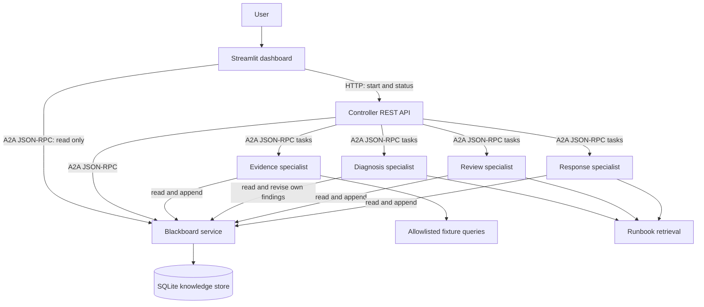

# Architecture and controller behavior

## Service boundaries

Only the Blackboard repository opens SQLite. The dashboard uses a read-only `dashboard` identity over A2A. The controller uses the configured `controller` identity for state changes and dispatches. The four specialists use their own configured identity and write only through Blackboard actions.

The controller exposes `GET /cases`, `POST /runs`, `GET /runs/{problem_id}`, and `GET /health`. It stores no knowledge independently: every decision begins with `read_blackboard`, is written as a `controller_decision`, and then the board is read again after a task. Dashboard refresh reads status and board state; it never starts work.

## Scheduling rules

The scheduler is a pure function of the current Blackboard snapshot, the number of started dispatches, and the configured limit. It selects one action at a time and uses semantic dispatch keys to avoid repeating work for unchanged inputs.

1. A current open evidence request schedules `evidence/collect_evidence`.
2. If the board has no observations, the Evidence Agent collects initial observations.
3. If observations are not represented in current hypothesis citations, or a current hypothesis was rejected, the Diagnosis Agent compares explanations again.
4. Each current hypothesis revision without a review schedules `review/review_hypotheses`. A review applies only to its exact target revision. If review records disagree, the newest review by creation time, revision, and entry ID supplies the effective verdict.
5. A supported hypothesis must have an `accept` review on that exact revision before the Response Agent can propose a plan.
6. Each current solution revision must be reviewed. Completion requires an accepted supported hypothesis, an accepted current solution, at least one valid observation reference, and at least one runbook reference.
7. If no eligible action remains, evidence is unavailable, the dispatch cap is reached, or the deadline expires, the controller closes as `unresolved`. A specialist/transport/Blackboard failure closes as `blocked`.

The review and response steps therefore depend on actual entries and revisions. They are not a hard-coded sequence. An unavailable evidence request is linked to an observation with `fulfilled_request_status: unavailable`, which prevents an endless retry.

## Memory and provenance

The Blackboard returns both the latest logical entries and full revision history. Entry IDs stay stable when an owner revises a finding; the revision number advances. Reviews cite the target entry ID and exact revision. Evidence observations include tool name, query, fixture source IDs, observation time, returned records, and any evidence-request link. Runbooks have stable source IDs.

Problem IDs scope all reads and writes. Ground-truth files under `evaluation/answer_keys/` are used only by the evaluation script after a run; specialist tool access is rooted in `fixtures/` and `runbooks/`.

## Runtime mode and limits

`CAMPUS_MODEL_MODE=offline` is the default and is shown explicitly in the dashboard. Offline agent results are fixture-driven; no model provider is called. `CAMPUS_MODEL_MODE=live` uses the provider adapter configured with base URL, model name, and API key. Do not leave provider credentials in the repository.

The controller starts with a maximum of 12 specialist dispatches, a five-minute case deadline, and a 12,000 reported-token ceiling (`CAMPUS_MAX_DISPATCHES`, `CAMPUS_CASE_TIMEOUT_SECONDS`, and `CAMPUS_MAX_RUN_TOKENS`). The token ceiling is checked between specialist tasks against provider-reported usage. Offline mode reports token usage as unmeasured because the fixture adapter does not report tokens. Missing provider usage also remains unmeasured or partial; no token count is estimated. These limits are bounded-work controls, not an exact billing cutoff for an already in-flight request.

## Local prototype limits

The service credentials and fixture dataset are intended for a classroom demonstration on one machine. This is not connected to campus infrastructure, does not execute remediation, and is not a production authorization or identity design. Model confidence is an uncalibrated self-assessment and does not participate in completion checks.
