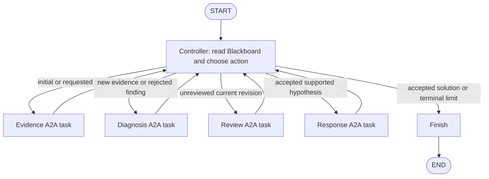

# LangGraph and LangChain implementation

The application uses LangGraph for controller orchestration and LangChain for specialist model chains and tools. A2A remains the service transport, and the Blackboard remains the shared, versioned memory.

## Workflow



`src/campus_blackboard/controller/runner.py` builds and invokes the `StateGraph`. Its conditional edges use `choose_next_action` from `controller/scheduler.py`. This preserves evidence-request priority, exact-revision reviews, dispatch deduplication, and completion gates. Review can route back to Evidence or Diagnosis rather than advancing along a fixed sequence.

Every node reuses the existing A2A dispatch path and authenticated Blackboard client. Graph state holds the current snapshot, dispatch plan and usage counters during the invocation. The Blackboard persists findings and audit records. No LangGraph checkpointer is configured: restarting the controller does not resume an interrupted graph invocation automatically.

Case deadlines still cancel in-flight provider work, dispatch and token limits still apply, and failure bookkeeping persists a blocked or unresolved outcome. A per-invocation journal retains side effects when a node fails before committing its returned graph state. Concurrent investigations do not share graph state.

## Specialist model chains

`src/campus_blackboard/langchain_adapter.py` provides the LangChain `BaseChatModel` implementation and a runnable chain:

`ChatPromptTemplate → CampusChatModel → StrOutputParser → existing domain validator`

`SpecialistRunner` invokes this chain for model decisions, with role, purpose and repair-attempt metadata. The domain validator still checks references against actual Blackboard entries, evidence grounding, allowed actions, and output structure. Invalid output gets one repair attempt with validation feedback.

The chat model delegates to the existing configured provider adapter. Your Codex CLI login, OpenAI-compatible credentials, model choice, provider timeouts and offline mode keep their current behavior. There is no additional provider API key required. Provider-reported usage remains measured data; missing token counts are not estimated. Offline fixture responses also pass through the LangChain chain when a specialist requests a model decision.

## Tools

`src/campus_blackboard/tools/registry.py` registers four LangChain structured tools: `query_metrics`, `query_logs`, `get_change_history`, and `search_runbooks`. Actual tool execution uses LangChain `invoke`, rather than a separate uninstrumented dispatch path. Strict schemas reject extra arguments and type coercion; fixture validation and source provenance remain intact. The registry assigns the case ID from the authenticated task context and rejects an attempt to override it through model arguments.

The tools stay read-only and allowlisted. This migration does not introduce shell access, arbitrary external tools, or remediation execution. The controller retains scheduling authority; specialists produce validated findings and evidence requests.

## Running the migrated application

Use Python 3.11. Stop a currently running instance, install the locked dependencies, and restart all services:

```bash
uv run --locked python scripts/stop.py
uv sync --locked --extra dev
uv run --locked python scripts/start.py
```

Open [the dashboard](http://127.0.0.1:8501) and start a fresh investigation. Your existing `.env` is retained. To demonstrate without a provider call, set `CAMPUS_MODEL_MODE=offline` before restarting.

The controller health endpoint reports `orchestrator: langgraph` and `agent_framework: langchain`. Finished run results include `workflow_nodes` containing the actual visited nodes. Existing Agent theatre and Blackboard activity still use the same persisted dispatch and knowledge events.

## Verification

```bash
uv run --locked python -m pytest
```

The suite includes framework callback checks, provider cancellation, structured-tool validation, conditional graph routing and bounded-work checks. Independent service acceptance tests launch a throwaway SQLite store and real local A2A services, and exercise the database, DNS and insufficient-evidence fixtures without paid provider calls. Existing provider tests use local doubles; running this suite does not validate a live provider account or model availability.
