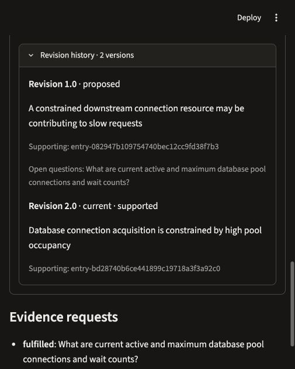

# Campus IT Incident Investigator

## MAAI904 Assessment 2 - Implementation Summary

**Project topic:** Blackboard system on top of A2A  
**Submission period:** 2026  
**Assessment context:** 30% of the course grade; live demonstration target 10-12 minutes

### Summary

This prototype investigates synthetic campus IT incidents through a shared, persistent Blackboard. Four independent specialist services gather fixture evidence, compare possible causes, review claims and prepare a bounded response proposal. A separate deterministic controller chooses each next task from the current board state. Specialists communicate with one another's shared workspace through an A2A Blackboard service; they do not open its database directly.

The main scenario begins with intermittent learning-portal timeouts and slow page loads. Database connection exhaustion and traffic overload are plausible explanations until the system gathers targeted measurements. The design preserves evidence provenance and earlier hypothesis revisions so a presenter can explain what changed and why. It can also stop with an unresolved result when evidence is unavailable.

The application runs in explicit offline fixture mode by default. No live model-provider calls have been made. The model adapter can be configured later for an OpenAI-compatible provider, but the project has not selected a provider or model identifier. Offline responses are fixture-driven, so their outcomes do not demonstrate live LLM reasoning. Recommendations do not change campus systems.

This summary describes the implemented prototype and its measured checks. It does not claim a campus deployment or production authorization design. See the accompanying submission checklist for student names, IDs, and actual individual contributions, which must be completed by the students.

<!--PAGEBREAK-->

## 1. Architecture and service boundaries

[[ARCHITECTURE_DIAGRAM]]

The dashboard starts a run through the controller's REST API and reads the board through a read-only A2A identity. The controller calls the Blackboard for state and delegates specialist tasks through A2A JSON-RPC. Evidence, Diagnosis, Review, and Response each run as independent A2A services. The Blackboard service alone opens the SQLite database. This keeps validation, identity checks, revision rules, and audit records at one boundary.

The Blackboard uses the A2A Python SDK 1.3.0 with the A2A 1.0 JSON-RPC binding. Services publish Agent Cards at `/.well-known/agent-card.json`. A2A carries structured application data, including Blackboard action envelopes such as `read_blackboard`, `write_blackboard`, `update_knowledge`, and `get_problem_status`. Those names are project-level payload actions, not custom A2A RPC methods. The implementation follows the tagged SDK server and client patterns and the v1 message/part conventions [3, 4].

The controller exposes `GET /cases`, `POST /runs`, `GET /runs/{problem_id}`, and `GET /health`. The Streamlit dashboard uses a periodic fragment to refresh status without starting more work. A run starts only when the user presses the start button. This separation makes the interface inspectable while keeping control decisions in the controller.

<!--PAGEBREAK-->

## 2. Blackboard state and controller loop

Each problem has a status, current board revision, timestamps, and configured work limits. Knowledge is stored as typed entries: observations, hypotheses, evidence requests, reviews, solutions, and controller decisions. Entries retain their author, time, and revision. The Blackboard returns the latest logical entries and revision history. Updates use an expected revision so a stale write can be rejected instead of silently replacing newer knowledge.

An observation includes the tool name, query, fixture source identifiers, returned records, observation time, and any evidence-request link. A hypothesis cites observation IDs and can record supporting and contradicting evidence, open questions, and its state. A review targets an exact entry revision. A solution cites both observation entries and stable runbook section IDs. Reviews and decisions remain in the history after later revisions.

The controller re-reads the board after every specialist task. Its scheduler is a pure function of the current snapshot, dispatch count, and configured cap. An open evidence request takes priority. Otherwise, it gathers initial observations, revisits a diagnosis when relevant evidence changes, schedules a review for each current hypothesis revision, and creates a response proposal only after a supported hypothesis passes review. Each solution revision also needs its own accepted review. Semantic dispatch keys prevent repeating the same action when the relevant inputs have not changed.

Completion requires an accepted supported hypothesis, an accepted current solution, at least one valid observation reference, and at least one runbook reference. An unavailable query is recorded against its request and does not loop forever. The controller ends unresolved when evidence or work limits prevent completion. A specialist, transport, or Blackboard failure ends as blocked. This creates a checkable reason for the final status instead of treating a confident-sounding response as proof.

<!--PAGEBREAK-->

## 3. Specialists, tools, and model configuration

**Evidence Agent.** Selects an allowlisted fixture query and records the tool, query, source IDs, results, and rationale. Available tools cover metric queries, log queries, and change history. An open request must match its requested tool and query exactly.

**Diagnosis Agent.** Maintains competing hypotheses, cites known observation entries, records unresolved questions, and can request additional evidence. The validator rejects unknown evidence IDs. A hypothesis marked supported must have claim-relevant returned records.

**Review Agent.** Checks a specific hypothesis or solution revision. An accepted diagnosis must cite relevant observations. An accepted response must contain bounded actions, evidence references, and exact runbook sections retrieved for that proposal. A review can reject a claim or request further evidence.

**Response Agent.** Produces a recommendation with one to five ordered actions, a purpose and expected check for each, evidence IDs, runbook IDs, and caveats. The prototype records a proposal. It does not execute those actions.

Tools read only the local synthetic fixtures and curated runbooks. The answer keys under `evaluation/answer_keys/` are reserved for the evaluator and are not exposed to specialists. Local A2A service calls use configured actor credentials. Message data does not set the authenticated identity, and the dashboard has a read-only identity. This is a classroom boundary, not a production identity system.

Offline mode is the default and makes no provider call. A configurable model adapter accepts an OpenAI-compatible base URL, model name, and API key for future use. The team has not selected those settings or made a live provider request. Token usage is therefore unmeasured in offline runs. When provider-reported usage exists, the controller checks it between tasks; it does not estimate missing usage or promise an exact billing cutoff for an in-flight call.

<!--PAGEBREAK-->

## 4. User flow and demonstration case

The Streamlit interface lets a presenter select one of three synthetic cases: database connection-pool exhaustion, a DNS fault, or insufficient evidence. It displays the explicit runtime mode, investigation status, board revision, specialist dispatch count, observations, hypotheses, activity, controller decisions, and proposed response. Refresh reads state; it does not schedule work.

*Figure 1. Recorded Blackboard hypothesis history from the earlier offline db_pool demonstration. It shows a proposed connection hypothesis revised to a supported pool-occupancy explanation after targeted evidence. The screenshot set also includes the completed status and response views. No remediation was executed.*

The planned walkthrough uses the database-pool case. Initial observations leave multiple causes plausible. The Diagnosis Agent can request a pool measurement. The controller dispatches Evidence Agent for that request. The new observation is linked to the request, the diagnosis can be revised while older history remains visible, and Review Agent checks the exact current hypothesis revision. Response Agent then retrieves relevant runbook material and records a proposed action plan. The presenter should point to the specific IDs and revisions shown by the actual run rather than narrating a prewritten result.

The insufficient-evidence case demonstrates a truthful stopping condition. If a requested query is unavailable or the evidence cannot satisfy the completion rules, the board records that limitation and the controller closes unresolved. No cause should be inferred from an empty result.

<!--PAGEBREAK-->

## 5. Evaluation and verification record

### Current verification after six fixes

**Full suite.** 108 tests passed in 13.58 seconds. Regressions cover observation revisions, completion at exact dispatch and reported-token limits, deadline expiry during board operations, repeated and concurrent evidence delivery, malformed tool arguments, and strict missing-evidence evaluation. The scheduler requires a fresh diagnosis after changed observations; older hypotheses remain history and cannot authorize a new response. See `docs/bugfix-summary.md` for the defect-to-test record.

**Fresh A2A evaluation, offline mode.** The final retained evaluator record, `evaluation-20261107T070922Z.json`, contains nine fresh runs, three per fixture. The summed case elapsed time was 7.493 seconds. All three `db_pool` runs completed in 9 dispatches at board revision 32, with two observations, two hypotheses, one request, three reviews, and one solution. All three `dns_fault` runs completed in 5 dispatches at revision 18, with one observation, one hypothesis, two reviews, and one solution; no follow-up request was needed.

All three `missing_evidence` runs ended unresolved in 6 dispatches at revision 22, with two observations, three hypotheses, one unavailable request, one review, and no solution. The recorded reason was `hypotheses_rejected_without_new_evidence`. All three strict missing-evidence gates passed: an actual unavailable request was recorded, no cause was accepted, and no response was produced. An operationally blocked run now fails that evaluation check instead of being counted as a successful insufficient-evidence outcome.

**Protocol and audit checks.** The final evaluation recorded 434 successful audit rows and zero audit failures. All 60 specialist finishes had `TASK_STATE_COMPLETED`; task and context identifiers were retained. Persistence, authenticated actor identity, idempotency, optimistic revision conflicts, and concurrent storage checks are covered by the retained verification record and tests.

**Expected false checks.** The rough literal answer-key label check was false in all nine runs; it is not a reasoning score. DNS request-link checks were false because no request was needed. Missing-evidence cause, response, and fulfilled-request checks were false because the request was unavailable and the case correctly ended without a cause or solution.

### Evidence boundaries

The final evaluator JSON is included in `submission/evidence/`. The earlier `evaluation-20261106T181622Z.json` remains unchanged as historical evidence from before these fixes: the earlier verification had 61 passing tests and nine fixture runs, including missing evidence ending after 10 dispatches. The bundled screenshots also show that earlier offline demonstration. They illustrate the interface and provenance, rather than the latest verification run.

The configurable model adapter was checked against a fake local HTTP endpoint, including reported usage, malformed responses, and timeout handling. No paid or external model provider was contacted. Offline case outputs are fixture-driven and token use is unmeasured. Tests check software behavior; fixture evaluation checks statuses, evidence links, revisions, and response gates. Neither establishes live LLM quality or a statistical success rate. Manual review should trace each recommendation to the underlying observations and retrieved runbook sections.

<!--PAGEBREAK-->

## 6. Limits, AI use, and references

### Limits and next work

The cases, metrics, and logs are synthetic. The system is not connected to campus infrastructure. It does not repair an incident, execute a response, or establish an operational diagnosis. Model confidence is an uncalibrated self-assessment and does not participate in completion checks. The local credentials and single-machine SQLite store are for a classroom prototype. The controller's defaults are 12 specialist dispatches, a five-minute case deadline, and a 12,000 provider-reported token ceiling checked between tasks; offline token use remains unmeasured.

For the live demonstration, start a fresh `db_pool` run and show the targeted observation, the revised hypothesis history, and the reviewed response. The bundled screenshots document an offline completed run. A live provider can be configured later if the students select one and explicitly choose to make provider calls. Real campus integration, automatic remediation, deployment hardening, broader model evaluation, and a production identity design remain outside this prototype.

### AI-use statement

AI coding assistance supported implementation and preparation of these submission materials. Students should review the work, verify this disclosure against the course policy, and update it if the actual tools or scope differ. No live model provider was called for the fixture-driven investigations described here. This project record does not establish which student completed which work; the students must complete the contribution statement in the accompanying checklist.

### References

1. MAAI904, *Assessment 2: Project*, 2026 course brief, supplied DOCX. The brief specifies the 30% assessment weight, Week 11 timing, 10-12 minute live presentation, and group submission of a deck, repository/tool screenshots, and a 5-7 page implementation summary.
2. MAAI904, *Blackboard system on top of A2A*, supplied project topic DOCX.
3. A2A Python SDK, v1.3.0, [Hello World Agent server sample](https://github.com/a2aproject/a2a-python/blob/v1.3.0/samples/hello_world_agent.py).
4. A2A Python SDK, v1.3.0, [A2A Protocol v1.0 migration guide](https://github.com/a2aproject/a2a-python/blob/v1.3.0/docs/migrations/v1_0/README.md).
5. Pydantic, [Models and validation documentation](https://pydantic.dev/docs/validation/latest/concepts/models/).
6. Streamlit, [`st.fragment` API reference](https://docs.streamlit.io/develop/api-reference/execution-flow/st.fragment).
7. Project implementation sources: `README.md`, `docs/architecture.md`, `docs/evaluation.md`, `docs/demo-script.md`, and `docs/technical-references.md`.
